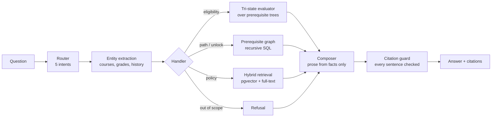

# UBC Course Advisor

Ask in plain English whether you can take a UBC course, what a course unlocks,
or what an academic policy says, and get an answer computed from the UBC
Vancouver Academic Calendar, with citations to the exact source.

> **Unofficial.** This is a student project, not academic advising. Prerequisites
> may be waived at instructor discretion and the Calendar is the authoritative
> source. Confirm anything that matters with an academic advisor.

## Demo

<!-- Replace with your recording: a GIF or a link to the video -->
*Screen recording of the deployed app: login, an eligibility check, a
"can't tell" verdict, a clarification, a cited policy answer, and a refusal.*

The app is not publicly hosted. See [Status](#status) for why.

## What it does

| You ask | You get |
|---|---|
| "I got 72 in MATH 226 and passed CPSC 210. Can I take CPSC 221?" | **Yes**, with the requirement check and a link to the calendar entry |
| "I passed MATH 226 and CPSC 210. Can I take CPSC 221?" | **Can't tell**: the 68% minimum can't be checked without your grade |
| "Is 320 open to me?" | "Which course do you mean?" with buttons for CPSC 320, MATH 320, … |
| "What does CPSC 213 unlock?" | The courses that require it, and those it's one option for |
| "Can I retake a course I already passed?" | An answer from the policy pages, citing the specific sections |
| "Should I take CPSC 320 or 322?" | A refusal: that's advice, not something the calendar answers |

## How it works

**The model never decides eligibility.** It turns the question into structured
data and the computed result back into prose. Everything in between is
deterministic and checked.



1. **Ingestion (offline).** A polite fetcher (robots.txt, rate-limited) caches
   calendar pages. Prerequisite text is converted by an LLM into JSON boolean
   trees (all-of / one-of / minimum grade / …), then validated mechanically:
   schema, no invented course codes, no dropped clauses. Policy pages are
   chunked on headings and embedded for retrieval.
2. **Routing and extraction.** A small model classifies the question; a second
   extracts the target course and the student's history, and every extracted
   code is checked against the database.
3. **Handlers.** Eligibility runs a tri-state evaluator (*satisfied*, *not
   satisfied*, *can't tell*), so a missing grade is never assumed to pass.
   Path and unlock questions traverse the prerequisite graph. Policy
   questions use hybrid vector + keyword search.
4. **Composition and the guard.** The composer writes prose from the computed
   facts only. A guard then checks every sentence for invented course codes,
   numbers, advice, history claims, and unverifiable "the calendar doesn't
   say" statements, regenerating once or falling back to a template.

## Results

Measured on a 50-question end-to-end evaluation set (40 answerable, 10 that
should be declined), scored against gold inputs rather than by a model:

| Metric | Result |
|---|---|
| Routing accuracy | 47/47 |
| Answer correctness | 39/40 |
| Refusal correctness | 10/10, with 0 false refusals |
| Unverified claims shipped | 0 |
| Latency | p50 4.7s, p95 9.7s |

Each stage also has its own evaluation: a hand-labeled golden set for
prerequisite extraction, recall@5 for retrieval, routing and entity holdout
sets, and composer drift checks. Details and the history of every number are
in [DECISIONS.md](DECISIONS.md).

## Stack

| Layer | Tools |
|---|---|
| Backend | Python, Flask, gunicorn, LangGraph |
| Models | Claude Haiku (routing, extraction, composition), Voyage embeddings |
| Data | PostgreSQL 16 + pgvector, psycopg connection pool |
| Frontend | React, Tailwind CSS, Vite |
| Infrastructure | Docker, Terraform, AWS (ECS Fargate, RDS, ALB, Cognito, ACM, ECR, Secrets Manager, CloudWatch) |
| Testing | pytest (311 tests), Vitest (15 tests), evaluation harnesses in `eval/` |

## Repository layout

```
agent/    router, entity extraction, handlers, composer, citation guard
api/      Flask API, response serializer, gunicorn config
core/     evaluator, prerequisite graph, retrieval, connection pool
ingest/   fetcher, course parser, LLM tree extraction, policy chunking
eval/     evaluation sets and runners (results are kept local, not committed)
web/      React + Tailwind UI, with a mock mode for offline UI work
infra/    Terraform for the AWS deployment
db/       SQL migrations
tests/    pytest suite
```

## Local setup

Requires Docker, `make`, and Node 22 (for the UI).

```bash
cp .env.example .env    # add ANTHROPIC_API_KEY and VOYAGE_API_KEY
make up                 # Postgres + the API on localhost:8000
make smoke              # readiness check and one real question
```

The repository contains no calendar data. To build the database, run the
ingestion pipeline yourself (it makes paid API calls, and the
[Terms of Use](#status) apply):

```bash
make fetch && make parse && make extract && make rebuild-edges   # courses
make fetch-policy && make chunk && make embed                    # policy pages
```

Then the UI:

```bash
make web-install
make web-dev            # http://localhost:5173, proxying the API
make web-mock           # or: canned answers, no API or database needed
```

### Commands

| Command | Does |
|---|---|
| `make up` / `make down` | Start / stop the stack (data is kept) |
| `make reset` | Destroy the database volume and re-run migrations |
| `make test` / `make web-test` | Backend / frontend tests |
| `make ask Q="..."` | Ask a question from the terminal |
| `make eval-e2e` | Run the 50-question end-to-end evaluation |
| `make psql` | Interactive database session |

## Deploying to AWS

The deployment is private: one admin-created Cognito user with MFA behind an
HTTPS load balancer, with the app's port reachable only from the load
balancer. It was built for a demo and then torn down; everything is in
`infra/`, so it can be rebuilt with a few commands:

```bash
cp infra/terraform.tfvars.example infra/terraform.tfvars   # your IP and domain
terraform -chdir=infra init && terraform -chdir=infra apply
make aws-keys           # API keys into Secrets Manager
make db-dump && make db-restore
make aws-deploy         # build, push, roll out the current commit
make aws-dns            # then add the two printed DNS records
terraform -chdir=infra apply
make aws-user EMAIL=you@example.com
make aws-start          # prints the URL
```

`make aws-stop` pauses it; `make aws-destroy` removes everything. Running cost
is roughly $60/month, mostly the load balancer, so it isn't left up.

## Status

Complete, and built for **personal use**. UBC's Terms of Use allow personal,
non-commercial use of calendar content, but reproducing or redistributing it
requires written consent. So the app is not publicly hosted, scraped pages
are never committed, and calendar-derived text was removed from this
repository's history. See [DECISIONS.md](DECISIONS.md).

## Design decisions

Every significant choice, with the reasoning and the measurements behind it,
is logged in [DECISIONS.md](DECISIONS.md).
